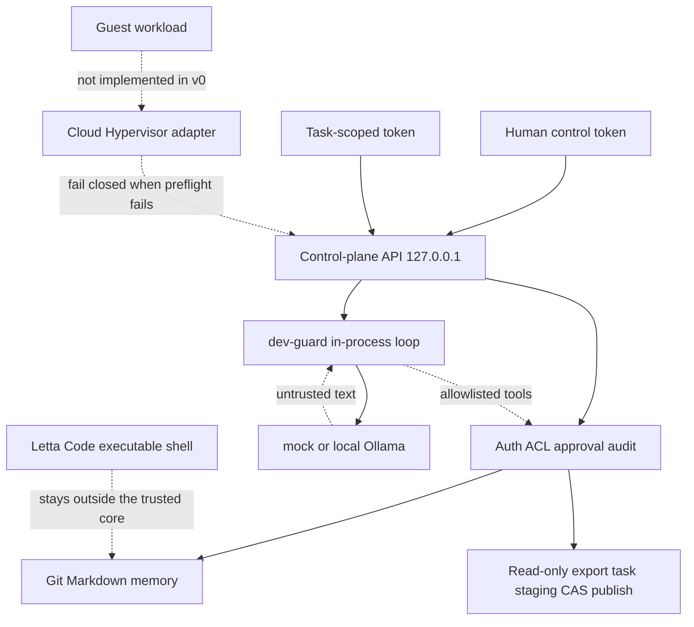

# Architecture

SSIOS v0 is an upper-layer prototype of a local personal Agent OS: a trusted control plane, a local model gateway, Letta MemFS-compatible memory, task-scoped grants, project shared storage, human approval, and an audit log. It does not provide a verified microVM fast start, and it does not describe the dev profile's in-process isolation as a virtualization boundary.

## Trust boundary

The trusted part is the control-plane process: token checks, project ACL, the memory broker, the storage broker, approval binding, the audit log, and the dev-guard tool loop. Model output is not trusted. A future guest is not trusted. Letta Code can execute a shell, so it cannot sit inside the trusted core even with a local backend. The optional upstream mode keeps `letta` outside the broker and calls only the documented JSON subcommands. Approval is still done with the human token. It does not switch to `letta-memfs-compat` when the CLI fails.

The isolation level of `dev-guard` is `process-jail`. It runs the agent loop in the same process and allows only `memory.read`, `memory.search`, and `storage.read`. `approve: true` from the model is ignored and written to the audit log. This stops a wrong tool call. It does not stop a bug in the control-plane process itself, and it is not a substitute for KVM.

## Runtime profiles

| Profile | Behavior |
| --- | --- |
| `dev` + `dev-guard` + `mock` | Default. Local loopback, a deterministic model, no network |
| `dev` + `dev-guard` + `ollama` | The same control plane, with the model changed to local Ollama and no cloud fallback |
| `production` or `cloud-hypervisor` | The process does not serve tasks. It prints preflight and exits with status 2 |

The Cloud Hypervisor command follows the upstream docs: `--memory size=...M,shared=on`, one `--fs` per shared directory, a disk that is private to the task, `--serial off`, and `--console off`. `--net` does not appear in the arguments. Asking for a guest network returns `network_denied`.

The share plan is two virtiofs mounts:

- Input export: `virtiofsd --readonly --cache never --sandbox namespace`
- Output staging: a separate virtiofsd that points only at that task's staging directory

The memory repository, the vault, the token directory, and the user's home directory cannot be share paths. v0 does not actually start virtiofsd or cloud-hypervisor. `execution_implemented` is fixed at false. If KVM, a binary, the kernel, or the disk image is missing, the matching check fails. Whether or not the checks are complete, `launch()` raises `microvm_fail_closed` and does not call the host task function.

## Request path

1. The human token submits a synthetic task and names the project, the export revision, and the paths that may be read.
2. The control plane issues a task token that covers only that project and those paths. The static worker token has no project grant.
3. dev-guard loads root core memory first, then reads topic files and the granted input as the model asks.
4. The summary is written to the task-private staging area and frozen. A memory proposal is written outside the Git repository and marked `untrusted`.
5. Two approvals each bind the action, the payload SHA-256, the expected revision, a random nonce, and the `bound_hash` computed from those, and they carry an expiry.
6. Only after the human token submits that exact binding does the control plane publish the file or commit Git. A repeat submission is rejected.
7. After the process restarts, core files still load from Git HEAD and the topic summary is read by path.

## Where data lives

The state directory defaults to `.ssios/` and is not committed.

- `secrets/`: the human token and the worker token, mode 0600
- `auth/tokens.json`: only token hashes and grants
- `memory/<project>/repo/`: the MemFS-compatible Git repository
- `memory/<project>/provenance.json`: trust and tombstone metadata, not the source of facts
- `storage/exports/`: immutable read-only exports with a manifest hash
- `storage/tasks/<id>/`: task-private staging
- `storage/published/`: CAS published revisions
- `vault/`: a synthetic canary that no API serves
- `audit/audit.jsonl`: action metadata and hashes

The facts are the Markdown in Git. A file whose source is not in `{synthetic_seed, approved}` is not given to a task token. A file written straight into the worktree is shown to the human as `unknown`.
