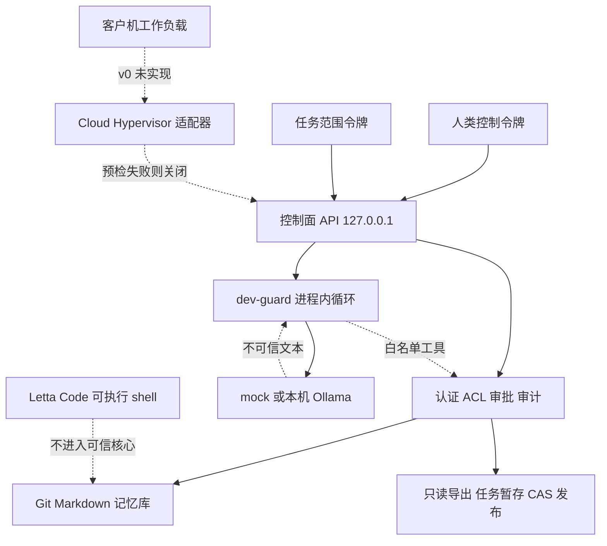

# 架构

SSIOS v0 是本地个人 Agent OS 的上层原型：可信控制面、本地模型网关、Letta MemFS 兼容记忆、任务范围授权、项目共享存储、人类审批和审计。它不提供已验证的 microVM 快速启动，也不把开发档的进程内隔离说成虚拟化边界。

## 信任边界

可信部分是控制面进程：令牌校验、项目 ACL、记忆经纪、存储经纪、审批绑定、审计和 dev-guard 的工具循环。模型输出不可信。未来的客户机不可信。Letta Code 能执行 shell，因此即使使用本地后端，也不能放进可信核心。可选的上游模式把 `letta` 放在经纪之外，只调用文档里的 JSON 子命令；批准仍由人类令牌完成。它不会在 CLI 失败时改用 `letta-memfs-compat`。

`dev-guard` 的隔离级别是 `process-jail`。它在同一进程里跑代理循环，只允许 `memory.read`、`memory.search` 和 `storage.read`。模型里的 `approve: true` 会被忽略并记入审计。这能挡住错误的工具调用，不能挡住控制面进程自身的漏洞，也不能代替 KVM。

## 运行剖面

| 剖面 | 行为 |
| --- | --- |
| `dev` + `dev-guard` + `mock` | 默认。本机环回、确定性模型、无网络 |
| `dev` + `dev-guard` + `ollama` | 同一控制面，模型改为本机 Ollama，无云端回退 |
| `production` 或 `cloud-hypervisor` | 进程不提供任务服务。预检打印后以状态码 2 退出 |

Cloud Hypervisor 命令按上游文档构造：`--memory size=...M,shared=on`、每个共享目录一个 `--fs`、磁盘是任务私有路径、`--serial off`、`--console off`。参数里不出现 `--net`。请求客户机网络会得到 `network_denied`。

共享目录计划是两条 virtiofs：

- 输入导出：`virtiofsd --readonly --cache never --sandbox namespace`
- 输出暂存：单独的 virtiofsd，只指向该任务的 staging 目录

记忆库、vault、令牌目录和用户主目录不能成为共享路径。v0 没有真正拉起 virtiofsd 或 cloud-hypervisor。`execution_implemented` 固定为 false。缺 KVM、二进制、内核或磁盘镜像时，对应检查为失败。无论检查是否齐备，`launch()` 都抛出 `microvm_fail_closed`，并且不会调用宿主机任务函数。

## 请求路径

1. 人类令牌提交合成任务，指定项目、导出修订和允许读取的路径。
2. 控制面签发只覆盖该项目和该路径的任务令牌。工作者静态令牌没有项目授权。
3. dev-guard 先加载根目录核心记忆，再按模型请求读取主题文件和授权输入。
4. 摘要写入任务私有暂存区并冻结。记忆提案写在 Git 仓库之外，标记为 `untrusted`。
5. 两张审批单分别绑定动作、载荷 SHA-256、期望修订、随机 nonce 和由此算出的 `bound_hash`，并带过期时间。
6. 人类令牌提交完全相同的绑定后，控制面才发布文件或提交 Git。重复提交被拒绝。
7. 进程重启后，核心文件仍从 Git HEAD 加载，主题摘要按路径读取。

## 数据位置

状态目录默认是 `.ssios/`，不入库。

- `secrets/`：人类令牌和工作者令牌，0600
- `auth/tokens.json`：只有令牌哈希和授权
- `memory/<project>/repo/`：MemFS 兼容 Git 仓库
- `memory/<project>/provenance.json`：信任和墓碑元数据，不是事实来源
- `storage/exports/`：不可变只读导出，带清单哈希
- `storage/tasks/<id>/`：任务私有暂存
- `storage/published/`：CAS 发布修订
- `vault/`：不通过任何 API 提供的合成金丝雀
- `audit/audit.jsonl`：动作元数据和哈希

事实以 Git 中的 Markdown 为准。来源不在 `{synthetic_seed, approved}` 的文件不会交给任务令牌。直接写进工作树的文件对人类显示为 `unknown`。
