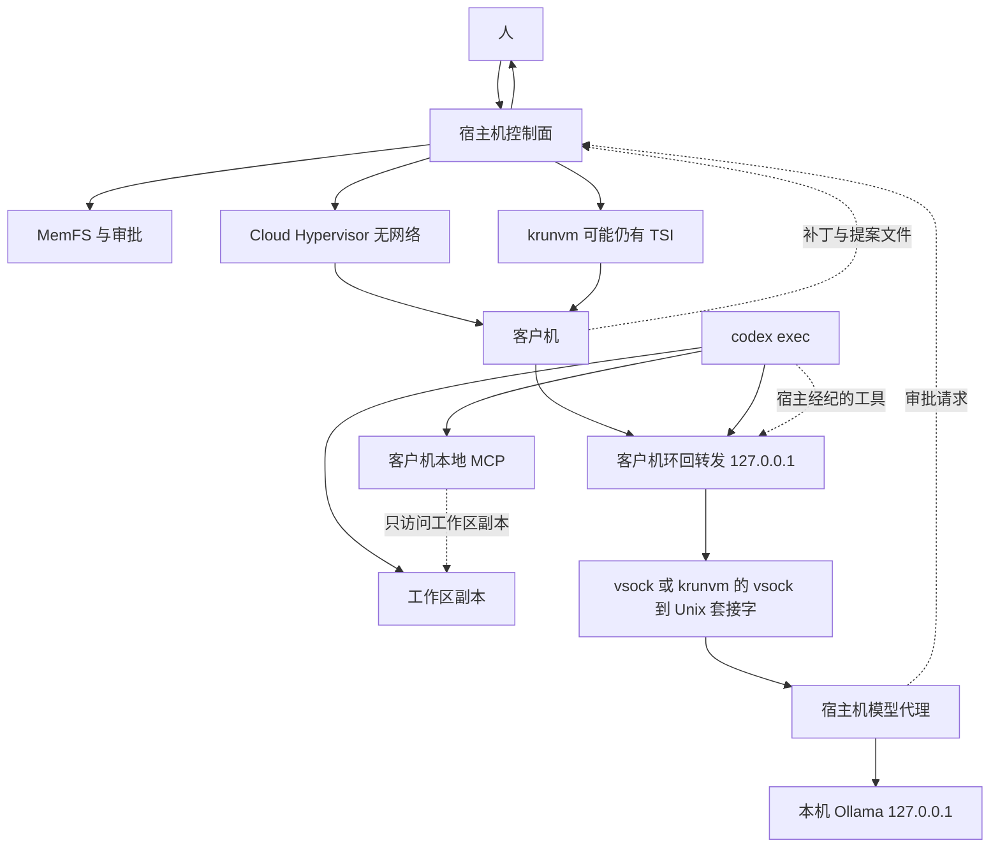

# 在 SSIOS 客户机里跑 Codex CLI

本文只是验证原型的软件架构，不是实现说明。事实核对日期是 2026-11-09。没有在本仓库里安装或运行 Codex，也没有把某个模型接到 Codex 上测过。标成「未核实」的句子不能当成已经试过。

## 要保住的边界

SSIOS 控制面留在宿主机。人类令牌、工作者令牌、审批（动作、载荷哈希、预期修订、nonce）、MemFS 写入和质量门都在宿主机。客户机拿不到这些令牌，也拿不到真正的 Ollama 地址。模型输出和 Codex 写出来的补丁、笔记、记忆提案都是不可信工件，先过质量门，再由人批准。没有云端回退。客户机起不来就失败关闭，不改在宿主机上跑 Codex。

两条运行路径不一样：

- Linux 上的 Cloud Hypervisor 不传 `--net`。这是硬隔离目标。客户机没有常规网络，只能走设计里选定的 vsock。
- macOS 上的 krunvm 0.2.7 没有关闭客户机网络的参数。它适合开发和对照，隔离弱于 Cloud Hypervisor。krunvm 的 TSI 仍可能让客户机里的进程自己去连网。设计不能把这条路径说成没有网络。

已有的 `guest_worker.py` 继续负责「读授权、写一次模型请求、写出摘要」。Codex 是另一种客户机代理，由配置 `[runtime] agent = "codex"` 选中。`agent` 缺省时仍走现在的 worker，不改变已在 Apple M4 上通过的 krunvm 摘要路径。

## 已核对的 Codex 事实

下列链接在 2026-11-09 打开过。Codex 变动很快，实现前要按当时的 tag 再对一次。

| 事项 | 结论 | 来源 |
| --- | --- | --- |
| 当时的最新稳定发布 | `rust-v0.167.0`，2026-11-06，不是预发布 | <https://github.com/openai/codex/releases/tag/rust-v0.167.0> |
| Linux 静态包 | 该发布同时提供 `codex-x86_64-unknown-linux-musl.tar.gz` 和 `codex-aarch64-unknown-linux-musl.tar.gz`，另有 `.zst` 和 `.sigstore` | 同上，GitHub release 资产列表 |
| 配置位置 | `CODEX_HOME`，默认 `~/.codex`。`config.toml` 在这里。命令行 `--config key=value` 的优先级高于文件 | <https://learn.chatgpt.com/docs/cli/reference>，以及仓库 `docs/config.md` |
| `--oss` | 使用本地开源模型提供方。具体是 `--local-provider`、配置里的 `oss_provider`，或在 LM Studio 与 Ollama 之间提示选择 | 同上 CLI 参考 |
| 内置 `ollama` 提供方 | 不能靠同名配置项覆盖。自定义端点要用**新的**提供方名字，并且不要同时用 `--oss --local-provider ollama`，否则会回到内置的 localhost 行为 | <https://github.com/openai/codex/issues/8240>，维护者 2026-06-12 关闭说明：换一个名字，或用 `CODEX_OSS_BASE_URL` |
| 线路协议 | 2026-11-09 的配置参考写明 `model_providers.<id>.wire_api` 只接受 `responses`，省略时也是它。`chat` 已被移除，留在文件里会导致整个配置加载失败 | <https://developers.openai.com/codex/config-reference>；<https://github.com/openai/codex/issues/41816> |
| 旧文档仍写 chat | 仓库里一份历史 `docs/config.md`（blob `88abbf58…`）仍把 `wire_api` 写成 `chat` 或 `responses`，并给过 `http://localhost:11434/v1` 的 Ollama 例子。以配置参考和 41816 为准，那份旧文过时 | 该 blob |
| 登录 | `model_providers.<id>.requires_openai_auth` 默认 false。设为 true 才走 OpenAI 认证。自定义提供方不要同时设置 `env_key` | 配置参考 |
| 非交互 | `codex exec`（短写 `codex e`）用于脚本。`--json` 输出按状态变化分行的 JSON。另有 `--output-schema` 和 `--output-last-message` | CLI 参考，`codex exec` 一节 |
| 沙箱 | `read-only`、`workspace-write`、`danger-full-access`。`codex exec` 默认只读。`--full-auto` 已不支持 | <https://learn.chatgpt.com/docs/non-interactive-mode>；<https://learn.chatgpt.com/docs/agent-approvals-security> |
| 审批策略 | `--ask-for-approval` 的取值是 `on-request` 或 `never`。这是 Codex 自己的暂停，不是 SSIOS 的人类批准。`--yolo` 会同时关掉沙箱和审批，本设计禁止 | 同上 |
| MCP | `[mcp_servers.<name>]` 支持 `command`/`args`/`env`（stdio）或 `url`（HTTP）。可限制 `enabled_tools`，也可用 `bearer_token_env_var` 指向环境变量名，而不是把令牌写进文件 | 历史 `docs/config.md` 的 `mcp_servers` 表；配置参考仍列出这些键 |
| 遥测 | 默认会向 OpenAI 发送用量与健康指标，不含文档所称的个人身份信息。`analytics.enabled = false` 关掉内置 Statsig。`otel.metrics_exporter` 默认跟着 analytics；要明确关掉应设为 `none`。OTel 日志导出默认关闭 | <https://learn.chatgpt.com/docs/config-file/config-advanced>；配置参考 |
| 更新检查与网页搜索 | `check_for_update_on_startup` 默认为真。`web_search` 默认 `cached`，会用 OpenAI 维护的索引；`live` 会真正访问外网。`--yolo` 时网页搜索会变成 `live` | 配置参考 |

未核实，实现前必须用钉住的二进制再测：

- Ollama 0.40.15（本仓库以前用过的版本）是否实现 Codex 要的 Responses API。Codex 侧 PR <https://github.com/openai/codex/pull/8798> 说内置 Ollama 会按 Ollama 版本在 Responses 和 chat 之间选择，但本设计不使用内置提供方。
- `codex exec --json` 每一行的字段名。文档只说是分行的 JSON 事件，没有在这里钉死 schema。
- 关掉 `analytics` 和 `web_search` 之后，进程是否还会在有网时连到 OpenAI。无网客户机上连不上就失败；有网的 krunvm 上这仍是残余风险。
- musl 包在客户机里的动态依赖。发布名是 `unknown-linux-musl`，通常可在只有证书和 CA 的根文件系统里跑，但是否完全静态没有在这里用 `ldd` 看过。
- 发布资产的 SHA256。实现时从该 tag 的校验文件读取，本文不写未核对的哈希。

## 组件



Cloud Hypervisor 是要验收的隔离。krunvm 只作为 Mac 上的开发后端画在旁边。

## 一次任务的数据流

1. 人用现有的人类令牌发起任务。控制面检查身份、项目和输入修订，和现在一样。
2. 宿主机把**已经允许阅读的正文**复制到本次任务目录的 `input/`。不复制令牌、不复制 MemFS 的 `.git`、不写 Ollama 的真实 URL。
3. 宿主机准备 `scratch/`，写入只在客户机里使用的 Codex 配置。`base_url` 固定为 `http://127.0.0.1:9` 这一类环回地址，端口由实现钉死。配置里的提供方名字用 `ssios`，不用 `ollama`。
4. 启动客户机。Cloud Hypervisor 不添加网卡。krunvm 按它自己的方式启动，并在文档和状态里标明网络未关闭。
5. 客户机里的转发进程监听 `127.0.0.1`。它只把字节转到 vsock（Cloud Hypervisor）或 krunvm 0.2.7 已有的 `--vsock 端口:宿主机 Unix 套接字`。转发进程不解析提示词，也不持有人类令牌。
6. `codex exec` 把模型请求发到环回地址。宿主机代理检查这条连接来自 vsock，而不是来自宿主机上的任意进程，然后按策略调用本机 Ollama，再把 Responses 流送回去。
7. Codex 在客户机里用自带的 shell。工作目录只是本次复制出来的工作区。它可以改这个副本。
8. 需要宿主机才能做的事（读尚未授权的记忆、写 MemFS、发布）不在客户机里执行。它们变成宿主经纪的 MCP 调用，由控制面变成现有的审批单。
9. 客户机退出后，宿主机只收集约定目录里的工件：`scratch/last-message.md`、`scratch/events.jsonl`、`scratch/patch.diff`、`scratch/proposals/*.md`。这些文件不可信。
10. 质量门先看工件。通过之后才生成审批。人用人类令牌批准后，宿主机才写入 MemFS 或发布。客户机此时已经销毁。
11. 销毁客户机。krunvm 仍删除本次任务的虚拟机定义；镜像缓存可以留下，这和现在的 `vm-prepare` 一样。

任一步失败都停在失败状态。不自动改用 dev-guard，也不改用云模型。

## 宿主机模型代理

Codex 只会发 HTTP。客户机没有网卡时，它够不到宿主机的 `127.0.0.1:11434`。比较过三条路：

| 通道 | 做法 | 取舍 |
| --- | --- | --- |
| virtio-fs 上的请求文件 | 和现在的 `request.json` / `response.json` 一样 | Codex 不会读写这些文件。还得在客户机里再写一个 HTTP 服务器，把 HTTP 拆成文件。流式 Responses 会很别扭 |
| 串口 | 把 HTTP 帧塞进 virtio 串口 | 没有现成的 HTTP 客户端支持，调试和背压都差 |
| vsock 加客户机环回转发 | Codex 连 `http://127.0.0.1:端口`；转发进程把它送进 vsock；宿主机在 vsock 上提供 Responses API | Codex 不用改。Cloud Hypervisor 可以不加网卡。krunvm 0.2.7 的 `start --vsock` 已能把客户机的 AF_VSOCK 接到宿主机 Unix 套接字 |

选定第三种。

转发进程是客户机镜像里的一个小程序，只做 TCP 和 vsock 的字节拷贝，限制连接数和单请求大小。它不认识 JSON。宿主机代理才解析 Responses 请求。

宿主机代理对每个请求做这些事：

- 只接受来自本次任务 vsock 的连接。宿主机上的其他进程即使猜到路径也不能拿它当开放端口。
- 核对模型名在任务配置的允许列表里。不在列表里就拒绝，不转发。
- 去掉或拒绝任何 `Authorization` 里看起来像 SSIOS 令牌的值。客户机配置里的占位密钥是固定的短字符串 `ssios-guest`，只用于满足客户端要带一个头的情况。它不是人类令牌，也不能调用控制面。
- 记录请求字节数、响应字节数、耗时和模型名。不记录完整提示词到任务 API。完整正文只留在权限为 `0600` 的诊断文件，并且跑和现在一样的脱敏。
- 强制本次任务的输出上限和墙钟预算。超出就断开，任务失败。
- 只把请求转给配置里的本机 Ollama。Ollama 不在、返回错误或协议对不上时，任务失败。不改连别的主机。

代理不实现网页搜索，也不把 `web_search` 工具补上。客户机配置把 `web_search` 设为 `disabled`。

Ollama 是否提供 `/v1/responses` 未核实。若钉住的 Ollama 只有 chat，原型停在 M0 的模拟代理，直到换一个已经核实支持 Responses 的本机版本。不为此去接云端。

## 客户机里的 Codex 配置

配置由宿主机写进任务的 `CODEX_HOME`，再只读挂进客户机。示意：

```toml
model_provider = "ssios"
model = "qwen2.5-coder:7b"
check_for_update_on_startup = false
web_search = "disabled"

[analytics]
enabled = false

[feedback]
enabled = false

[otel]
metrics_exporter = "none"

[model_providers.ssios]
name = "SSIOS host proxy"
base_url = "http://127.0.0.1:9/v1"
wire_api = "responses"
requires_openai_auth = false

[mcp_servers.guest_fs]
command = "ssios-mcp-guest"
args = ["--root", "/workspace"]
enabled_tools = ["read_file", "list_dir"]

[mcp_servers.host_broker]
command = "ssios-mcp-host"
args = ["--vsock"]
enabled_tools = ["memory_propose"]
```

不使用 `--oss`。提供方名字不是 `ollama`，避免内置提供方把 URL 改回 `localhost:11434`。

启动命令的形状是：

```text
codex exec --json --sandbox workspace-write --ask-for-approval never \
  --ignore-user-config -C /workspace \
  --output-last-message /scratch/last-message.md \
  "任务说明"
```

`--ask-for-approval never` 只表示 Codex 不再向一个不存在的终端提问。沙箱仍是 `workspace-write`。禁止 `--yolo` 和 `danger-full-access`。SSIOS 的批准不靠这个开关。

`--ignore-user-config` 避免读到镜像或宿主目录里意外留下的配置。实际配置目录由 `CODEX_HOME` 指向本次任务的只读配置。这一点要在钉住的版本上确认 `--ignore-user-config` 是否仍加载 `CODEX_HOME`。未核实之前，M0 的验收包含「客户机里除任务配置外没有别的 config.toml」。

## 工具

两类工具，不能混。

客户机本地：

- Codex 自带的 shell 和补丁。工作目录是 `/workspace`，对应宿主机上本次复制的目录。沙箱是 `workspace-write`。
- 只读 MCP `guest_fs`，同样只看见这个目录。
- 这些调用不经过 SSIOS 审批。它们改不到 MemFS，也读不到宿主机的秘密。质量门只看离开客户机的工件。

宿主经纪：

- MCP 服务器 `host_broker` 的二进制在客户机里，传输仍走 vsock。它不在客户机里执行记忆写入。
- 每个调用在宿主机上变成现有的审批请求：动作、载荷哈希、预期修订、nonce。人批准之前，MemFS 不变。
- 原型第一个宿主工具只做 `memory_propose`：把客户机交来的 Markdown 提案交给现有的 `memory.commit` 审批。不新增批准语义。
- 拒绝 shell、拒绝发布到客户机看不见的路径、拒绝带着令牌的参数。

Codex 自己的审批提示如果在 `never` 下变成拒绝，任务失败并留下 JSONL。不把这种拒绝自动换成 SSIOS 批准，也不为了让它通过而去掉沙箱。

## 工件与质量门

客户机可以产生：

- 最后一条消息
- `codex exec --json` 的事件流
- 工作区副本上的 diff
- 零个或若干记忆提案

宿主机在虚拟机退出后读取这些文件。事件流里的文字不能直接当命令。diff 只作为提案展示。记忆提案走现有审批。质量门沿用现在的规则：过短、残缺、复述内部字段、或把模板当内容，都不进入批准。Codex 若写出 `approve` 之类的字样，和现在的模型输出一样忽略。

人在控制面上看见 diff 和提案后再决定。批准绑定的仍是载荷哈希、修订和 nonce。

## 客户机镜像

镜像在构建时定死，运行时不安装软件包，也不访问网络去升级 Codex。

- 基础系统使用已经在用的钉死摘要。当前样例是 `python:3.12-alpine` 的清单摘要 `sha256:e064671ca452259bab50e8e2c7bd896e39e9a343bb06ca25234adf6fe18d0fc7`。Codex 原型若改基础镜像，要另写摘要，不能在运行时 `apk add`。
- Codex 二进制取 `rust-v0.167.0` 的 musl 包：x86_64 用 `codex-x86_64-unknown-linux-musl.tar.gz`，Apple Silicon 上的 Linux 客户机用 `codex-aarch64-unknown-linux-musl.tar.gz`。下载地址形如 `https://github.com/openai/codex/releases/download/rust-v0.167.0/<文件名>`。
- 构建脚本核对发布页上的校验和或 sigstore。校验失败就停止构建。本文没有抄入哈希。
- 转发进程和两个 MCP 小程序一起放进镜像，版本和 Codex 一样钉死。
- 镜像里不放 `auth.json`，不放人类令牌，不放宿主机的 `~/.codex`。

krunvm 路径用这个 OCI 镜像。Cloud Hypervisor 路径用由同一批文件打出来的 initramfs 或根磁盘，避免两套内容漂移。运行时只挂上本次的 `input/`、`scratch/` 和 `workspace/`。

## 配置

示意，尚未实现：

```toml
[runtime]
backend = "cloud-hypervisor"   # 或 macos-vm
agent = "codex"                # 缺省时保持现在的摘要 worker
guest_image = "docker.io/library/python@sha256:e064671ca452259bab50e8e2c7bd896e39e9a343bb06ca25234adf6fe18d0fc7"
macos_vm_volume = "/Volumes/krunvm"
guest_prepare_timeout_seconds = 600

[agent.codex]
model = "qwen2.5-coder:7b"
max_output_tokens = 4096
max_request_bytes = 200000
max_tool_rounds = 8
task_timeout_seconds = 180
```

`macos_vm_volume` 只用于 `vm-doctor` 的只读报告，默认 `/Volumes/krunvm`，与 krunvm 0.2.7 提示的默认挂载点相同。卷未挂载或 `diskutil info` 看不出 Case-sensitive APFS 时，医生报告失败原因，但不因此阻止一次已经能跑的 krunvm 任务。医生不执行 `hdiutil`，也不执行会创建或附加卷的 `diskutil`。

外接磁盘上的稀疏镜像由人自己做，例如：

```bash
hdiutil create -size 60g -type SPARSE -fs "Case-sensitive APFS" -volname krunvm /path/to/external/krunvm.sparseimage
hdiutil attach /path/to/external/krunvm.sparseimage
```

`volname` 为 `krunvm` 时，系统把它挂到 `/Volumes/krunvm`。路径里不要写具体的人或盘名。krunvm 第一次若还没有 `storage_volume`，由人在终端里回答 `/Volumes/krunvm`。SSIOS 不代替回答。

## 失败时怎么停

| 情况 | 行为 |
| --- | --- |
| 客户机或 Codex 二进制起不来 | 任务失败，`isolated` 仍为 false。不在宿主机上启动 Codex |
| 镜像拉取超过准备超时 | 失败，诊断里有 `krunvm create` 的退出码和输出尾部。不把这次失败当成客户机已经隔离运行 |
| 转发进程或 vsock 断开 | 失败。不改把 `base_url` 指到真的 Ollama |
| 代理看到不允许的模型、过大的请求，或 Ollama 错误 | 失败。不换模型、不换主机 |
| Codex 非零退出，或没有约定工件 | 失败。已有的部分 diff 留在任务目录供人看，不自动入库 |
| 质量门拒绝 | 失败，不创建批准 |
| 人拒绝或审批过期 | 与现在相同：过期的单子保持过期，不延长、不重用 nonce |
| krunvm 有网且 Codex 仍试图外连 | 任务可以继续，但状态里必须写明后端是 krunvm、网络未关闭。这不是隔离成功 |

诊断文件权限 `0600`，任务 API 只给短的 `error_detail`。两者都要脱敏。

## 威胁

| 威胁 | 挡住了什么 | 剩什么 |
| --- | --- | --- |
| 客户机读人类令牌 | 令牌不进镜像、不进挂载、不进代理允许的头 | 若宿主机把家目录或状态根目录挂进去，这个保证就没了。实现不得这样做 |
| 客户机直接打 Ollama 或云 | Cloud Hypervisor 无网卡；配置里的 URL 只是环回转发 | krunvm 关不掉网络。恶意或被注入的 Codex 仍可能自己拨号。分析数据默认也会外发，必须在配置里关掉，并且无网才算真正挡住 |
| 提示注入 | 笔记是不可信输入。宿主工具仍要人批准 | 模型可能在工作区副本里乱改，或诱导宿主工具的参数。批准界面必须给人看 diff 和参数，不能只给一句「模型说可以」 |
| 模型不会用工具 | 失败关闭，不假装完成 | 小模型经常发不合 Responses 要求的工具调用。这会让 M1 的验收失败，不能靠放宽解析去接受 |
| Codex 沙箱被 `--yolo` 关掉 | 设计禁止这个旗标 | 镜像或配置若被换掉，宿主机仍只收集约定目录。但客户机内的进程就不再受 Codex 沙箱约束 |
| 转发进程被换成隧道 | 镜像在构建时钉死 | 运行时若允许客户机写镜像自己的二进制，这条就不成立。挂载必须让镜像只读 |
| 审批重放 | 沿用现有的哈希、修订和 nonce | 新代码若自己实现一套批准，就会绕开它。M2 必须调用现有审批，而不是在 Codex 对话里认 `yes` |

## 24GB M4 上的模型

统一内存要同时放 macOS、krunvm 客户机和模型。下面只按公开的体量做选择，没有在这台机器上用 Codex 跑过。

- 原型优先 `qwen2.5-coder:7b` 的量化版。权重大约数 GB，给客户机留出内存后仍比较宽裕。工具调用是否稳，未核实。
- `qwen3` 的 8B 一带可以作为对照。思考模型会吃输出预算，宿主机代理要保留现在的长度上限。
- `gpt-oss:20b` 更接近 Codex 文档里的 `--oss` 例子，但 20B 的 Q4 权重大约十多 GB，再加上上下文，24GB 机器上会和系统、客户机抢内存。只能作为可选配置，不能当默认。
- 14B 以上的 coder 变体同样可能把机器顶满。默认不选。

M1 的验收用 7B 档。若工具调用不合格，结论是「这个模型不够」，不是去接更大的云模型。

## 里程碑

每一级都要有命令输出、任务 JSON 和诊断文件。口头说明不算通过。krunvm 上的通过不能用来宣称 Cloud Hypervisor 已通过。

### M0：客户机里的 `codex exec` 加模拟代理

验收：

- Cloud Hypervisor 客户机里跑钉住的 `codex exec --json`，`--sandbox workspace-write`，没有 `--yolo`。
- 客户机配置里的 `base_url` 是环回地址。抓包或代理日志能看见请求只到 vsock 上的模拟 Responses 服务。
- 模拟服务不访问网络。Codex 退出码为 0，`last-message.md` 和 JSONL 出现在宿主机的 scratch。
- 进程环境和工作区里搜不到人类令牌。
- `analytics.enabled = false` 写在生成的配置里。无网卡客户机上不存在到外网的套接字。此项在 krunvm 上改为记录「有套接字也算失败」还是「只记录」必须在 M0 写进测试；默认按失败，因为这条路径不宣称隔离。

### M1：代理接到本机 Ollama

验收：

- 宿主机 Ollama 收到的模型名是配置里的那个，地址仍是宿主机环回。
- 客户机看不到 `11434`，也看不到宿主机的其他地址。
- 输出上限生效：超限的运行失败且没有批准。
- Ollama 停止时任务失败，错误里没有云端供应商。
- 若该 Ollama 不支持 Responses，本级标成阻塞，而不是改回未文档化的 chat。

### M2：一个宿主经纪的 MCP 工具

验收：

- 客户机调用 `memory_propose` 后，控制面出现一张普通审批，含载荷哈希、修订和 nonce。
- 人不批准时，MemFS 的 `git log` 没有新提交。
- 批准后只有提案里的路径被提交。
- 把人类令牌塞进工具参数会被拒绝，并出现在脱敏后的诊断里。
- Codex 沙箱仍是 `workspace-write`。

### M3：端到端任务和测试

验收：

- 一条 SSIOS 任务从复制输入、启动无网 Cloud Hypervisor、跑 Codex、收集 diff、质量门到人类批准，全部走现有 API。
- 测试覆盖：代理拒绝未知模型、客户机启动失败时不在宿主机跑 Codex、审批过期不被续期、工件里的 `<script>` 在界面上被转义。
- krunvm 上的同样场景单独记录，状态里 `isolated` 只有在约定的「无外连」检查也通过时才能为 true。做不到就保持 false，并写明网络未关闭。
- 文档里的版本、摘要和校验和与实际镜像一致。

## 不在这个原型里

不改审批语义，不把 Codex 放进可信控制面，不在客户机里放 MemFS 的写权限，不用 `--oss` 的内置 Ollama 路径，不在运行时下载 Codex 或模型。
